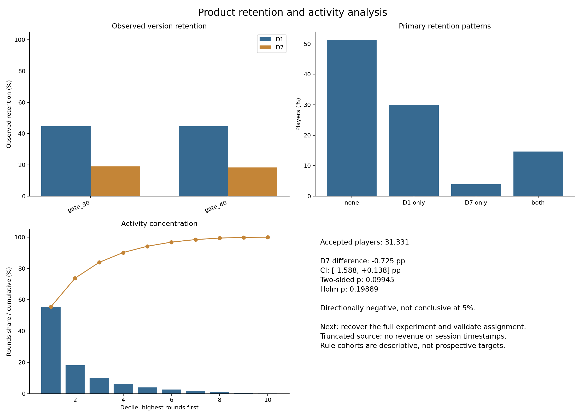

# Product retention and activity analytics

A reproducible business/product analytics portfolio project using the Cookie Cats mobile-game experiment. Python, SQLite, statistics, Excel and BI-ready exports turn player-level records into defined metrics, validated comparisons and a concise decision brief. The dataset remains a game dataset; this project makes no claim of pharma data or domain experience.

## Business questions

- How do observed return rates differ between assigned versions, and how uncertain are the differences?
- Which transparent retention/activity cohorts describe the population?
- How concentrated is activity, and what does an average conceal?
- Can SQL, Python, Excel and dashboard inputs reconcile to the same definitions?

## Data and provenance

The original setup script points to this [public Cookie Cats CSV](https://raw.githubusercontent.com/ryanschaub/Mobile-Games-A-B-Testing-with-Cookie-Cats/master/cookie_cats.csv). A byte comparison shows that this repository's raw file is an **exact truncated prefix**, ending inside the final record. There is no evidence of deliberate random sampling. The acquisition date and reason for truncation are unknown.

The raw file is unchanged. Only the hash-verified incomplete trailing record is quarantined; valid high-round records are retained. The population and maximum differ from the full source because this is a prefix, not because an outlier cap was applied. Counts and hashes are recorded in [metrics.json](outputs/metrics.json) and [the audit](docs/audit_notes.md).

Each row is one userid, assigned version, cumulative rounds, and supplied D1/D7 return flags. Rounds cover the stated fourteen-day window. No timestamps independently verify timing or allow daily trajectories.

## Methods and key findings

The corrected retrospective analysis declares two-sided tests as primary, adjusts the D1/D7 family, and reports effect sizes and uncertainty. Rule cohorts are primary. K-means is retained only as a secondary descriptive comparison, with retention-feature leakage disclosed.

<!-- METRICS:START -->

The local raw file has **31,332 records**, including **1** incomplete trailing record; **31,331 players** are analyzed. It is an exact byte prefix of the declared source (**90,189 rows**). Maximum rounds: **2,961** locally versus **49,854** in that source. Valid outliers are retained.

| Baseline metric | Result |
|---|---:|
| D1 retention | 44.67% (13,996 players) |
| D7 retention | 18.66% (5,845 players) |
| Mean / median rounds | 51.16 / 16.0 |
| Total rounds | 1,602,825 |
| D7 conditional on D1 | 32.85% |
| D7-only players | 1,247 |

| Metric | Gate 30 | Gate 40 | Difference (pp), CI | Two-sided p | One-sided p | Holm p |
|---|---:|---:|---|---:|---:|---:|
| D1 | 44.67% | 44.67% | +0.002 [-1.099, +1.102] | 0.99780 | 0.50110 | 0.99780 |
| D7 | 19.02% | 18.29% | -0.725 [-1.588, +0.138] | 0.09945 | 0.04972 | 0.19889 |

Primary tests are two-sided at alpha **0.05**, adjusted across D1 and D7 with Holm. Intervals are **95%** marginal Newcombe intervals. Effects are gate_40 minus gate_30; one-sided alternatives are exploratory gate_40 < gate_30.

**D7: directionally negative, not conclusive at 5%.** The data do not justify a definitive rollout or rollback recommendation.

| Primary cohort | Players | Size | Rounds share | Mean / median rounds | D1 | D7 |
|---|---:|---:|---:|---|---:|---:|
| D1 only | 9,398 | 30.00% | 29.15% | 49.72 / 32.0 | 100.00% | 0.00% |
| D7 only | 1,247 | 3.98% | 5.89% | 75.73 / 44.0 | 0.00% | 100.00% |
| both | 4,598 | 14.68% | 53.14% | 185.25 / 127.0 | 100.00% | 100.00% |
| none | 16,088 | 51.35% | 11.81% | 11.77 / 6.0 | 0.00% | 0.00% |

The highest-round decile contributes **55.55%** of activity. Engagement-tier versus D7 association has Cramer's V **0.6030**, separately from the A/B test.
Secondary K-means agreement: adjusted Rand index **0.6755** with retention cohorts and **0.4935** with cohort-by-tier groups. Retention is included in those model features, so segment retention is partly true by construction.

<!-- METRICS:END -->

The complete [statistical report](outputs/statistical_results.md) includes both tails, Pearson cross-checks, relative lift, odds ratios and intervals, bootstrap intervals, and SRM. [Profile tables](outputs/tables/) include cohort-by-tier detail, version shares and descriptive within-segment contrasts with intervals.



## Limitations and interpretation

The incomplete prefix may not represent the full experiment. Assignment and independent observations are assumptions; passing SRM cannot verify them. Cohorts and tiers use post-assignment outcomes, so their version comparisons are not causal subgroup effects. D7 does not require D1; marginal rates are not a survival funnel.

Rounds are not revenue. There is no monetization, cost, session duration, level history, demographic or calendar data. No causal explanation for fatigue, churn timing or habit formation is established. Segments defined by retention cannot validate retention prediction. The dashboard tracks a reproducible snapshot; time-series performance tracking needs dated observations.

## Deliverables

- [Stakeholder brief](outputs/insights_brief.md): findings, implications, recommendations and caveats.
- [Excel workbook](outputs/excel/player_analytics.xlsx): Data table, live formula summaries and native charts. Includes PivotTable instructions; no prebuilt PivotTables are claimed.
- [Native Power BI project](outputs/powerbi/ProductAnalytics.pbip): performance, experiment and concentration pages with a semantic model and DAX measures. [Opening and refresh instructions](outputs/powerbi/README.md); [validation evidence](outputs/powerbi/validation.md).
- [BI exports and dashboard specification](outputs/bi/dashboard_spec.md): fact/dimension CSVs, aggregates, DAX and Tableau guidance.
- [Quality report](outputs/data_quality_report.md), [business rules](docs/business_rules.md), [methodology](docs/methodology.md), and [old/new comparison](outputs/metric_comparison.md).

## How to run

Python 3.10+ is required. Run from the repository root:

```bash
python -m venv .venv
# Activate on Windows:
.venv\Scripts\activate
# Or macOS/Linux:
source .venv/bin/activate

python -m pip install -r requirements.txt
python scripts/run_all.py
python -m pytest -q
# Full release check: repeat the pipeline and compare metrics, then run tests.
python scripts/validate_pipeline.py
```

Normal runs work offline, use fixed random seeds, leave the raw CSV unchanged, and regenerate derived data, SQLite, metrics, figures, Excel, BI snapshots and reports. Requirements pin direct dependencies; runtime versions are recorded in metrics.json. The audit evidence is frozen separately; the audit scripts are optional forensic tools and are not run by normal automation.

All empirical narrative values are generated from metrics.json. Excel summaries contain live formulas with metric-derived preview caches. Tests inspect formulas, data, chart presence and caches; LibreOffice recalculation is tested only when installed and otherwise explicitly skipped. Cached-value previews of every worksheet were reviewed using a separate renderer. Native Excel visual rendering remains unverified.

Open `outputs/powerbi/ProductAnalytics.pbip` in Power BI Desktop and select **Home → Refresh** to load its embedded snapshot. No source paths or credentials are needed. Close Desktop before rebuilding the pipeline, then reopen and refresh. DAX has been executed in the local Power BI engine and reconciled to pandas, including filtered contexts. Native report rendering remains unreviewed because the app-control runtime failed to initialize; inspect the pages before presenting. To repeat the native checks with the project open, run `pwsh -File scripts/validate_powerbi.ps1` followed by `python scripts/powerbi_validation.py`. Normal Python/CI runs recheck the archived engine results against matching model definitions and current expected values; they do not launch Desktop.

CI runs the pipeline and tests on the configured Python versions. Individual script names are retained, but the orchestrator is the recommended entry point.

## Repository structure

```text
data/                  immutable raw CSV and regenerated analytical tables/database
scripts/               validation, statistics, segmentation, reporting and orchestration
sql/analysis.sql       documented questions, executed and reconciled to pandas
docs/                  audit, business rules and methodology
outputs/metrics.json   numerical source of truth and provenance
outputs/figures/       generated explanatory charts
outputs/excel/         workbook with live formulas
outputs/bi/            fact/dimension tables, aggregates, DAX and dashboard specification
outputs/powerbi/       native PBIP report, TMDL model and engine validation evidence
outputs/tables/        complete descriptive segment profiles
outputs/sql/           reconciled SQL results
tests/                 quality, reproducibility, parity and reporting checks
.github/workflows/     automated validation
```

## How these methods transfer to business analytics

The transferable work is defining denominators and exclusions, checking data quality, building interpretable segments, measuring concentration, validating outputs across tools, and explaining uncertainty and the decision it supports.

Retention/persistence funnels require explicit milestone definitions and nested populations. Decile/Pareto analysis describes activity concentration without assuming monetary value. A/B testing requires an assignment protocol and a planned decision rule. Before/after testing additionally needs dated observations and a defensible comparison design; this dataset cannot supply those. These are analytical methods relevant across sectors, not evidence of commercial or clinical domain experience.
